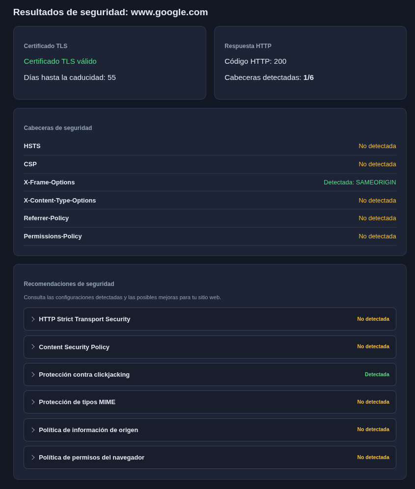

# WebGuard 🛡️

## Dashboard Preview



*Example security analysis of www.google.com showing TLS certificate information, HTTP security headers, and security recommendations.*

**WebGuard** is a Python-based web security monitoring application that analyzes website security configurations, detects changes over time, and generates alerts.

The project provides a local web dashboard, a REST API, persistent analysis history, scheduled monitoring, and email notifications through SMTP.

> **Project status:** v0.7 — Local development and testing. Not production-ready.

## Features

- **TLS certificate analysis:** Inspect website TLS certificate information.
- **HTTP security headers:** Check the presence of important HTTP security headers.
- **Security recommendations:** Provide recommendations based on analysis results.
- **Website monitoring:** Register domains and monitor them periodically.
- **Change detection:** Compare consecutive analyses to identify security configuration changes.
- **Security alerts:** Store detected changes and display alerts in the dashboard.
- **Analysis history:** Persist results using SQLite.
- **Email notifications:** Generate SMTP notifications for new security alerts.
- **Retry mechanism:** Retry failed notifications with a delay and a maximum number of attempts.
- **Local web dashboard:** View monitoring information through a browser.
- **REST API:** Access application endpoints through FastAPI.

## Technology Stack

| Technology | Purpose |
|---|---|
| Python | Application logic |
| FastAPI | REST API and web application |
| SQLite | Persistent data storage |
| HTTPX | HTTP requests |
| APScheduler | Periodic monitoring |
| SMTP / aiosmtpd | Email notifications and local SMTP testing |
| HTML, CSS, JavaScript | Web dashboard |

## Installation

### 1. Clone the repository

```bash
git clone YOUR_REPOSITORY_URL
cd WebGuard
```

Replace `YOUR_REPOSITORY_URL` with the GitHub repository URL once the project has been published.

### 2. Create a virtual environment

```bash
python3 -m venv .venv
source .venv/bin/activate
```

### 3. Install dependencies

```bash
python -m pip install -r requirements.txt
```

## Running WebGuard

### Start the web application

```bash
python -m uvicorn app.main:app --reload --host 127.0.0.1
```

Open the dashboard:

http://127.0.0.1:8000

FastAPI's interactive API documentation is available at:

http://127.0.0.1:8000/docs

### Start periodic monitoring

In a separate terminal, activate the virtual environment and run:

```bash
python -m app.services.scheduler
```

WebGuard checks registered domains every five minutes.

## Email Notifications

WebGuard supports SMTP notifications for detected security changes.

By default, email notifications are disabled.

### Start the local SMTP test server

```bash
python -m app.services.smtp_test_server
```

The test server listens on `127.0.0.1:1025` and displays received messages in the terminal. It does not deliver emails to external inboxes.

### Enable notifications for local testing

With the SMTP test server running, start the scheduler using:

```bash
WEBGUARD_EMAIL_ENABLED=true \
WEBGUARD_ALERT_RECIPIENT=pruebas@example.com \
python -m app.services.scheduler
```

The current SMTP configuration is intended for local testing only.

### Notification reliability

WebGuard stores notification states in SQLite:

- `pending`: Waiting to be sent.
- `sending`: Reserved for processing.
- `sent`: Accepted by the SMTP server.
- `failed`: Delivery attempt failed.

Failed notifications can be retried up to three times, with a five-minute delay between failures.

Abandoned sending reservations are identified for manual review to reduce the risk of duplicate delivery.

**Note:** SMTP acceptance does not guarantee delivery to a recipient's inbox.

## Running Tests

From the project root:

```bash
python -m pytest
```

Install `pytest` separately if it is not available in your development environment.

## Project Structure

```text
WebGuard/
├── app/
│   ├── database/
│   │   ├── db.py
│   │   └── ...
│   ├── services/
│   │   ├── security_analyzer.py
│   │   ├── headers_checker.py
│   │   ├── tls_checker.py
│   │   ├── monitor.py
│   │   ├── scheduler.py
│   │   ├── email_notifier.py
│   │   ├── notification_retry.py
│   │   └── ...
│   ├── static/
│   │   ├── index.html
│   │   ├── style.css
│   │   └── script.js
│   └── main.py
├── tests/
├── .gitignore
├── requirements.txt
└── README.md
```

## Security Considerations

WebGuard is an educational and development-stage security monitoring project.

It is **not intended for public deployment** in its current state.

Before production use, the application would require additional security measures, including:

- Authentication and authorization.
- Stronger protection against server-side request forgery (SSRF).
- Appropriate access controls and user isolation.
- Secure handling of SMTP credentials and configuration.
- Additional input validation, testing, and deployment hardening.

Use WebGuard only to analyze websites you own or are authorized to assess.

## Roadmap

Potential future improvements include:

- Enhanced alert management and filtering.
- Configurable SMTP providers.
- Improved dashboard visualizations.
- More comprehensive automated testing.
- Additional website security checks.
- Authentication and multi-user support.

## Version

**Current version:** v0.7

WebGuard is under active development as a personal cybersecurity and software engineering project.